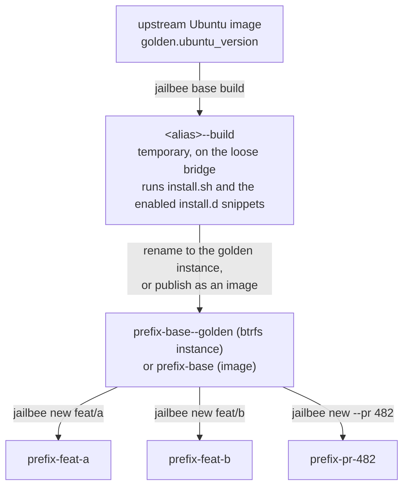
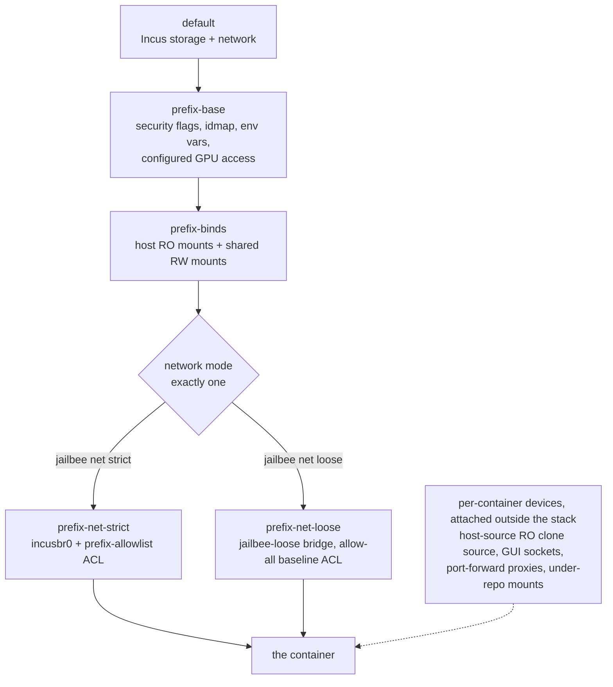
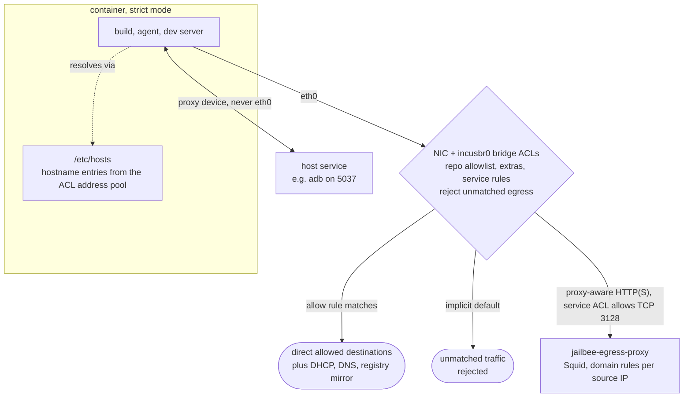

# Architecture

`jailbee` wraps [Incus](https://linuxcontainers.org/incus/) system containers to
give each git branch its own isolated, full-stack development environment.
This is a short overview of how the pieces fit together; see the code under
`src/jailbee/` for the authoritative behaviour.

## Where a container's config comes from

`jailbee.config` builds a validated `Config` from built-in defaults,
`~/.config/jailbee/global.yaml`, `<repo>/.jailbee/config.yaml`, and a host-local
repo overlay at `~/.config/jailbee/repos/<container_prefix>.yaml`, in that
order. Some settings are host-only, and lists have field-specific merge
rules; see [Configuration reference](config.md#configuration-layers).
Commands may load configuration more than once.

For an eligible directory without a repo config, the loader synthesizes the
repo layer from the global `scratch:` block unless `scratch.enabled: false`.
The synthetic layer goes through the same validation and host-local overlay
as a file-backed repo. Most downstream functions consume the resulting
`Config` without distinguishing its source; setup and provisioning paths do
check whether it was synthesized (see [`scratch`](config.md#scratch)).
After loading, callers treat the object as read-only and derive modified
copies rather than mutating the loaded configuration.

## Golden image

`jailbee base build` provisions a golden using the configured
`golden.alias` (normally `<container_prefix>-base`; scratch directories share
`jailbee-scratch-base`). The default flow runs
`src/jailbee/provision/install.sh` plus the selected `install.d/*.sh` snippets.
The image is stack-neutral by default (locale, prompt, GUI libs, GitHub CLI,
tmux, build-essential); additional runtimes and cloud helpers are opt-in via
`golden.stacks` or `golden.enable_snippets`. Image-installed browsers and
user/repo snippets also contribute (scratch builds exclude repo snippets).
`golden.disable_snippets` excludes named snippets, and a custom
`golden.provision_script` replaces the default flow.
See [Provisioning snippets](config.md#provisioning-snippets-installd).

The build runs on `defaults.storage_pool` (else the default profile's root
pool). What it leaves behind depends on that pool's driver. On **btrfs** the
golden is a stopped instance named `<alias>--golden`, and `jailbee new` makes a
container with `incus copy --instance-only`, an instant snapshot-based clone.
On other drivers the golden is a published image under `<alias>` and `jailbee
new` launches from it. Only one golden version is kept: every build replaces
the previous one and removes dated archives (`<alias>-YYYY-MM-DD`) left by
jailbee before 1.7.5. Creation speed and disk sharing depend on the Incus
storage backend: **copy-on-write is not a guarantee on every pool** (see
[Storage](storage.md)). Rebuilding the image
does not replace existing development containers' root filesystems. They keep
their original base and subsequent changes; use a new container to adopt the
rebuilt image.

Here and below, `prefix` stands for the repo's `container_prefix`; the
diagram uses the normal alias. There is no archive of earlier builds.

## Layered profiles

Incus profiles are composable and independently swappable. For the **legacy
network generation**, a development container uses this stack:

Work-generation containers instead use `<prefix>-net-work` plus
`<prefix>-net-work-strict` or `<prefix>-net-work-loose` on the same work bridge
(see [Optional work-network generation](#optional-work-network-generation)).
The diagram's `incusbr0` is the default legacy bridge, not a required name.

`jailbee net strict|loose` preserves unrelated base/bind profiles, but also
updates the associated ACLs, hosts entries and proxy configuration. Config
changes are reconciled by `jailbee apply` without rebuilding the root
filesystem; some changes require a container restart, and changes to image
contents still require a new image and container.

## Shared state

`<shared_dir>` (default `~/.local/share/jailbee/shared/<container_prefix>`)
holds persistent caches and tool state separately from the host's usual
application directories. Which directories are attached depends on enabled
stacks, agents, browsers and integrations. Examples include package-manager
caches, JetBrains config/data and agent install/config directories. Most are
**shared read-write mounts**: one container's writes are visible to the others
using the same directory. Custom paths and credential groups can extend
sharing beyond one repo; this is not a confidentiality boundary.

A subset uses **pool slots** instead: the Gradle, Maven, Chrome and Firefox presets
allocate separate per-container directories under
`<shared_dir>/<host_subpath>/slots/`, reusing idle slots or seeding from an
existing slot. These reduce cross-container lock contention, but are not all
independent copies: configured artifact subtrees in the Gradle/Maven presets
are hardlinked during seeding, while mutable state is copied separately.
In-place writes to hardlinked files can affect other slots. See
[`pooled_caches`](config.md#pooled_caches) and `src/jailbee/pool.py`.

When enabled, the host-global `jailbee-registry-mirror` service caches Docker
image pulls across repos. The optional `jailbee-litellm` service similarly
provides a host-wide model gateway, but keeps its rendered configuration and
OAuth state in an Incus volume rather than these shared cache directories;
see [LiteLLM gateway](litellm.md).

## Agent credential pool

Each supported coding agent gets one account pool: a host-wide store of
parked logins, **one live login per agent per holder** (usually one holder per
repo, or one shared credential group — see
[`credentials`](config.md#credentials)). Switching moves credentials rather
than intentionally keeping two active copies. Same-filesystem moves use
atomic rename; cross-filesystem moves use copy, fsync, then unlink, leaving a
duplication window that a crash can preserve. This is not a guarantee against
manual copies or running processes retaining credentials. A group is a single
shared *name*; each agent resolves it to its own holder directory, so several
agents can be pooled in the same group without sharing a credential.
`src/jailbee/accounts/` holds this as a generic engine
plus one adapter per agent. `accounts/engine.py` is the store —
park/switch/remove, slot naming, member resolution — and knows nothing about
which agent it serves; `accounts/models.py` carries the agent-agnostic types
(`Identity`, `Slot`, `Member`, `LiveAccount`); `accounts/groups.py` resolves a
container's credential group; `accounts/overview.py` renders every login on
the host, across holders; `accounts/selection.py` decides which login, and
whose, a command acts on when a reference or a menu spans several agents'
pools. Everything agent-specific — the credential
filename, how an account is named, session detection, what has to be
recorded beside a credential the engine just moved — lives behind the
`AccountAdapter` protocol in `accounts/adapters/base.py`;
`accounts/adapters/claude.py` is the only adapter today. The rule the split
establishes: **the engine knows no agent; an adapter knows one** — a second
agent's pool is a new adapter module, not a change to `engine.py`.

## Read-only host binds

Enabled integrations can expose host resources through read-only mounts:
the GnuPG key directory, an SSH agent socket, host-installed JetBrains
Toolbox/IDE binaries, host-sourced browser binaries, and the host's
`xterm-kitty` terminfo entry. Browser binaries may instead be installed in the
image, depending on configuration.

Read-only prevents filesystem writes **through that mount**; it does not
prevent reading or copying secret keys, or using the capabilities of a
mounted Unix socket. GPG integration exposes the host key directory, not just
agent sockets. The shared writable SSH configuration directory is a separate
resource from the forwarded agent socket. See [Security and
limitations](security.md).

## Egress allowlist and `/etc/hosts` pinning

`strict` network mode (the default) rejects unmatched egress using Incus ACLs.
The effective policy includes `egress_allow`, host-local repo and container
extras, and feature-driven additions for enabled agents, JetBrains and GitHub.
It also permits DHCP, TCP/UDP DNS on port 53 to any destination, and configured
service endpoints such as the registry mirror and proxies. It is not a
read-only GitHub policy: allowed HTTPS destinations can carry writes when a
client has suitable credentials.

`jailbee init`, `jailbee apply` and the installed refresh service resolve
hostnames to IPv4 and maintain a rolling address pool. By default, successful
refreshes retain addresses for 24 hours, capped at 20 per hostname; failed
lookups preserve that hostname's existing pool. Partial lookup failures warn,
while failure to resolve any configured hostname aborts an apply. Strict-mode
`/etc/hosts` pinning uses the same pool as ACL generation, reducing DNS drift
for clients that consult that file; it does not force every client to use it.

`jailbee apply --no-restart` refreshes ACLs and hosts entries in running
containers without restarting them. Periodic refresh requires the host refresh
timer to be installed and running. Legacy loose containers use a separate
bridge with an allow-all baseline ACL, not an ACL-free bridge; the optional
work-network generation below keeps both modes on one bridge.

### Optional work-network generation

`jb net migrate` is an explicit host-wide opt-in for **future** working
containers. It provisions `jailbee-work` with IPv4 DHCP/NAT, no routed IPv6,
and a DHCP/DNS-only baseline ACL before storing the new default. Both strict
and loose work instances keep the same filtered NIC, reserved IPv4 and bridge;
mode changes swap policy rather than moving the interface. Strict policy uses
the repo allowlist and per-container extras. Loose adds a source-IP-scoped
bridge exception for that container, so it does not widen another repo's
policy. Existing containers keep their legacy generation until destroyed;
`jb apply` reconciles both generations. `jb net migrate --undo` restores only
the future-container default and leaves in-use resources intact.

The shared bridge is host-wide across repositories. Before broadening its
policy JailBee checks all occupants and their IPv4 filtering. Doctor reports
foreign/unmarked occupants, duplicate reservations, missing filtering and
policy-marker inconsistencies rather than treating the host default as the
instance's mode. The generation requires one-time host firewall setup on
firewalled systems; reachability is only verified by probing a running work
container (see [Installation](installation.md#host-networking-only-if-you-use-a-firewall)).
Loose networking on this bridge is IPv4-only. Removing a loose exception
blocks new forbidden connections, but an already established loose-created
flow may persist after returning to strict; strict is not immediate session
revocation.

Port forwards sit outside this mechanism by construction. A forward
(`host_ports` in config, or an ad hoc `jailbee port`) is one Incus `proxy`
device, and Incus's forkproxy connects directly into or out of the container's
network namespace instead of sending packets over the NIC — so the traffic
never traverses the bridge the ACL is attached to, and neither direction is
filtered by it. `jailbee net status` lists the active forwards next to the
strict-mode summary for that reason; see
[Security and limitations](security.md#port-forwards).

The main network paths for a legacy strict-mode container (default bridge
name shown). The proxy connection also traverses the NIC and its ACLs; the
Incus port-forward device does not:

Squid handles wildcard `egress_allow` entries, which an IP ACL cannot express.
Clients reach it on port 3128 through the `jailbee-services` ACL; Squid fetches
upstream from `jailbee-loose`. With the default `egress_proxy_always: true`,
work containers receive proxy variables in both modes from first boot.
**Applications must honor those variables**: this is not transparent routing,
and direct connections still face the NIC/bridge ACLs. Successful rule updates
can change access for running proxy-aware clients without a new shell; loose
clients are not restricted by the repo domain allowlist.

Always-on proxy variables remain stable across ordinary mode/allowlist changes,
not every configuration change. An endpoint change may require a new process
environment. Proxy synchronization failures warn rather than abort container
startup, so initial setup can leave variables missing, and a failed mode/rule
update can leave stale access until a successful sync.

#### Per-bridge client NICs

The proxy container has `eth0` on `jailbee-loose` (DHCP, the only default
route) and one further NIC per client bridge: `eth1` on `incusbr0`, `eth2` on
`jailbee-work` when that network exists. Each client NIC has a static address
and no default route. Clients talk to the proxy on its address on their own
bridge, so the traffic never crosses a router and keeps the client's real
source address, which is what the per-source rules match; a packet routed
through a masquerading gateway would arrive as the gateway. `security.ipv4_filtering`
is on for these NICs. Each repo's rules are one file in `/etc/squid/jailbee.d/`,
checked with `squid -k parse` before a `squid -k reconfigure`, and restored
if the check fails.

### Two filters, not one

The combined NIC/bridge box above represents two filtering layers. With
bridge traffic also passing through the inet-family forward hook, packets
must pass **both**. For legacy strict networking with the default bridge:

| Chain | Built from | Scope |
|---|---|---|
| `in.<ct>.eth0` / `fwd.<ct>.eth0` in `table bridge incus` | the container device's `security.acls` | one container |
| `acl.incusbr0` in `table inet incus` | `incus network set incusbr0 security.acls` | every container on the bridge |

With `net.bridge.bridge-nf-call-iptables=1`, bridge-forwarded IPv4 traffic
also traverses the inet-family forward hook. JailBee therefore reconciles the
shared bridge's ACLs as well as each NIC's. A NIC grant alone is insufficient
if the bridge rejects that destination; do not diagnose the cause solely from
a client's error text or timing.

The repo-specific ACLs feeding these layers are:

- `<repo>-allowlist` — `config.yaml`'s `egress_allow` plus host-local repo
  overrides. On both the NIC and the bridge.
- `<container>-extra` — one container's own overrides. On that container's
  NIC only.
- `<repo>-container-extras` — the union of every `<container>-extra` in the
  repo. On the **bridge only, never on a NIC**, so it widens the shared chain
  without handing one container another's grants. Rebuilt from the
  per-container ACLs whenever they change.

The shared `jailbee-services` ACL adds service access alongside those rules.
The bridge contains a union of grants across repos; strict-container
separation relies on the NIC layer, not on the shared bridge alone.

Work networking applies the same separation on `jailbee-work`, with its
DHCP/DNS baseline, `<repo>-work-container-extras` unions and source-IP-scoped
loose exceptions. Its filtered NIC and reserved IPv4 are essential to keeping
one container's loose exception from becoming another container's grant.

## Host <-> container git bridge

In clone mode, containers use `git clone --shared` from a read-only host-source
mount. Their `.git/objects/info/alternates` points at the host's object store,
so they need not copy all existing Git objects. New objects still take space,
and the checkout contains its own working files; neither disk usage nor
transfer size is a fixed amount independent of the changes. In `--mount`
mode there is no independent checkout: the container writes directly to the
host working tree, and the clone-mode Git bridge commands refuse it.

The host-side `jailbee git fetch/checkout/pull` commands fetch container commits
over an `ext::incus exec ... git upload-pack` transport into
`refs/jailbee/<container>/<branch>`. That transport does not contact GitHub.
`fetch` also attempts to create or fast-forward the corresponding host branch
and submodule branches. It does not switch branches, but **can fast-forward
the currently checked-out host branch and change its working tree**; diverged
or unsafe placements are reported rather than unconditionally overwritten.
`checkout` additionally switches onto the target branch; `pull` brings the
commits into its selected host target. Restricted remote SSH sessions refuse
operations that would write the host working tree.

`jailbee git push` is the inverse local transport. By default it prefers the
host's upstream-tracking ref and attempts a best-effort host-side fetch first;
`--from local` selects the local branch instead. It writes
`refs/jailbee/host/<branch>` in the container and creates or fast-forwards the
container's local branch where safe, skipping the checked-out branch for that
ref-placement step. Optional merge or rebase then acts on the container's
working tree. `jailbee git merge` between containers relays the source through
the host without checking it out there, and runs the merge in the target.
See [Git bridge](git-bridge.md) for flags, conflict handling and cleanup.

`jailbee pr` is also run on the host: it fetches the container branch locally,
pushes it upstream using host credentials, then opens or updates the GitHub PR
via `gh`. The bridge and publication do not require GitHub egress from the
container. Optional AI description generation runs an agent inside the
container and does need access to its configured backend.

## Dashboard state service

The terminal dashboard (`dashboard/tui/`, built with Textual) and optional Qt
frontend (`qtui/`) consume snapshots through `state_service/client.py`'s
`StateClient`; neither runs its own status-gathering loop. One on-demand
service per host user gathers container state and broadcasts snapshots over a
Unix socket. Its `Gatherer`
uses separate cadences for base state and more expensive Git status, avoiding
one polling loop per open dashboard. The service exits after an idle period
with no connected dashboards.

Frontend-independent models, columns, menus and dispatch live in the shared
`dashboard/` package; the state service and Qt frontend do not depend on the
terminal UI. This split keeps status collection separate from rendering.

## Orchestration broker

Container orchestration (a container starting and managing child containers)
is carried out on the host by a separate long-lived user service,
`jailbee-broker.service`, which polls the containers' outboxes and answers in
their inboxes. It is neither the dashboard state service nor the net-refresh
timer, for three reasons. The state service exits after its last dashboard
disconnects and is scoped to gather-and-render, while orchestration must run
unattended. The net-refresh timer is a one-minute `Type=oneshot`, so every
relay hop would wait up to a minute and systemd would kill the
container-creation workers left in its cgroup. And one long-lived process
serialises all orchestration actions without cross-process locking.

## Security model

Containers share the host kernel (the Linux VM's kernel on macOS). Bind mounts,
shared caches, credentials, sockets and forwarded ports are deliberate paths
across the boundary, not resources isolated by the container root filesystem.
Disabling an agent's own sandbox or confirmations does not remove those trust
requirements. See [Security and limitations](security.md) before choosing what
to expose to an unattended agent.
