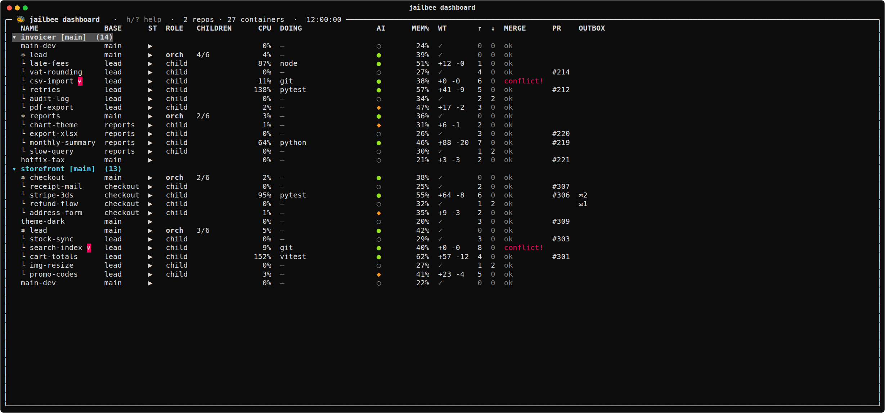
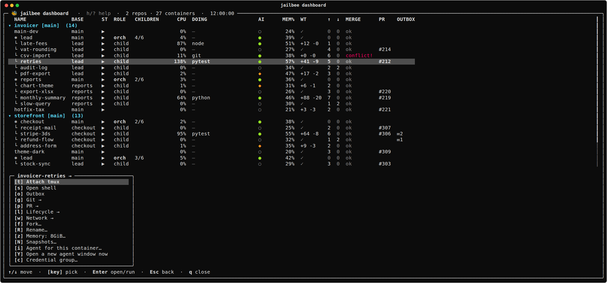
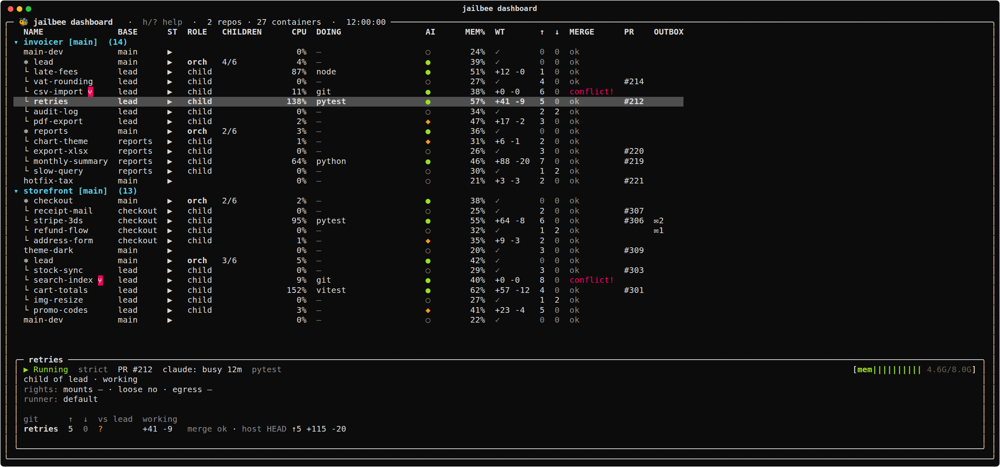
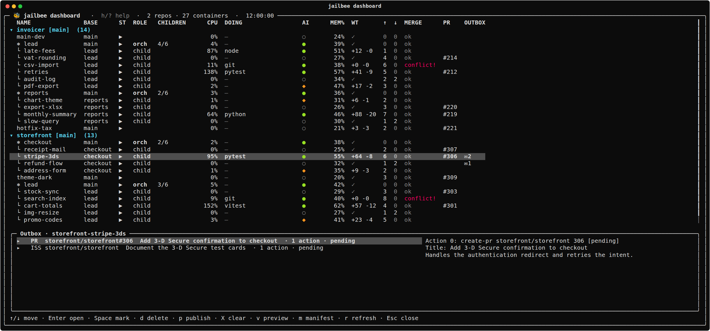
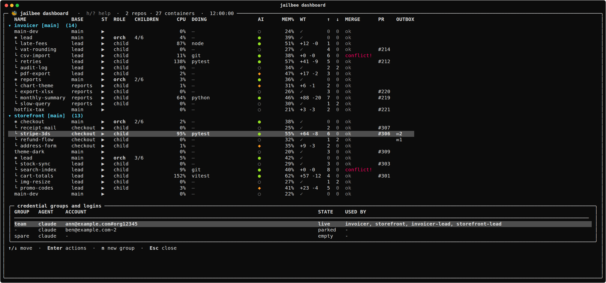
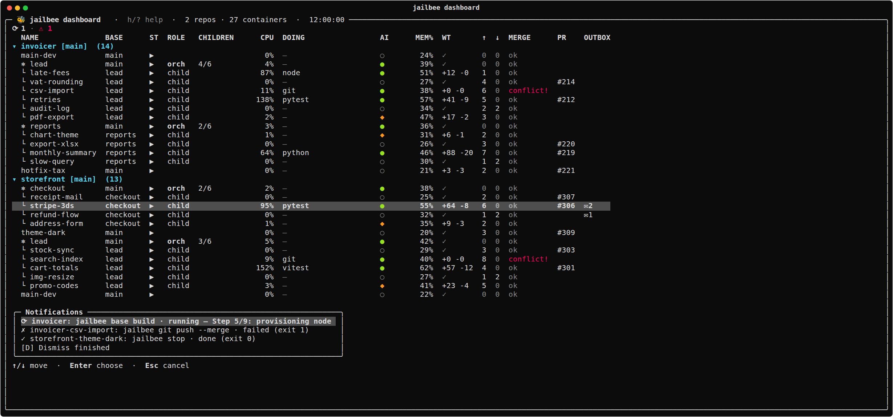
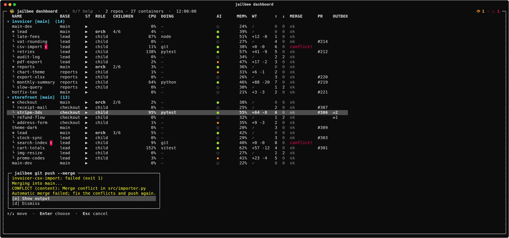
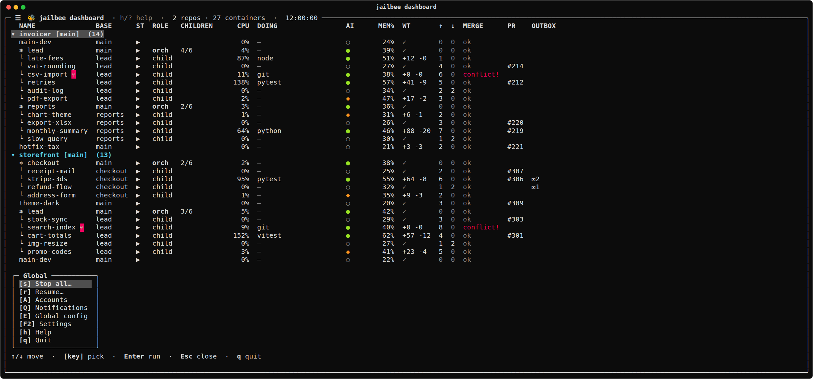

# The terminal dashboard

How do I use `jailbee dashboard` to watch and drive my containers?

`jailbee dashboard` (alias `jailbee tui`) is a live, auto-refreshing table of
the containers of every repository you use JailBee with. You read what each
container and its agent is doing, and you act on a container from its menu
without leaving the dashboard. This page is a tour, a keys cheat sheet, a
menu map, the common tasks and then the full reference. Open it with:

```bash
jailbee dashboard
```

The screenshots on this page come from a seeded demo, not from a real
session: the repositories, containers and agents are made up.

## Tour

The table has one row per container, grouped under a header row per
repository. An orchestrator is marked `⎈`, and its children are listed
directly under it:



Enter opens the menu of the highlighted row. Every entry shows its own key in
brackets. Most letters also work in the table without Enter: `g` opens Git on a
container row or the Agent picker on a repo row. F10 or the title's ☰ opens Global:



The details panel under the table (`v` shows or hides it) holds everything
known about the highlighted container or repo. A repo header's card also lists
notices, such as an upgrade that owes `jailbee apply`:



The Outbox box shows what an agent in a container has staged for GitHub, as a
tree beside a preview. You mark, delete or publish from there:



`A` opens the credential groups and stored logins:



Every action the dashboard starts becomes an entry in its notification queue.
Once anything has run, a badge `⟳ R · ? P · ✗ F` appears at the top-right of the
title (R running, P awaiting an answer, F failed). Its bold running glyph uses
the active theme's accent and advances one frame per refresh while work runs.
Pending questions use `?` and the same accent in both the badge and queue rows,
with the state text "awaiting answer"; only failures use red `✗`. The pending
count is omitted when zero; zero running and failed counts stay dim.
`NO_COLOR` keeps the emphasis without emitting colours. On narrow terminals the
title shortens before the badge; when both cannot fit, only the badge remains,
ellipsised if needed (at six columns or fewer, only the border fits). Click it or press `Q`
to open the list, newest first. Here a base build is still running (its last output line is on the row),
a push failed and a stop finished:



Choose an entry to see its state and the tail of its output. `o` shows all of
it, and `d` dismisses a finished entry (`D` in the list dismisses every
finished one):



Background commands leave their questions in the queue without interrupting
what you are doing. A silent notice names the command and `Q`; select its
"awaiting answer" entry with Enter or a click to open the question modal.
Several commands can wait independently, without a timeout. If a command's
prompt channel closes, its question is removed, even beneath another screen;
the command's final state stays in the queue. A question opens
immediately while you are with its action: its critical output modal is on top,
or you have not pressed a key, clicked or opened another overlay since starting
it or answering its previous question. Refreshes do not count as interaction.
Each question shows the command, its target and the tail of its output.
**Later**, also Esc, closes it without answering; reopen it from the queue when
ready. **Abort command**, also Ctrl-C within the question, cancels the command.
Returning from a tmux hand-off opens the queue for new attention items, never
a question modal by itself.

Creating a container queues any existing-branch confirmation there too;
declining shows the "Pick a different name" hint, not a failure. If
creation fails before its background worker starts, the reason stays as a
failed queue entry until dismissed, even when no container row exists yet.

Background actions run in the per-user state service through the shared action
runner, not in the terminal dashboard. Every connected dashboard in the same
repository scope sees the entries and live output; connecting later includes the
output so far. Dismissing a finished entry clears it in every dashboard.
Critical output opens automatically only in the dashboard that started it;
other dashboards can inspect its entry without a terminal hand-off block.
Lifecycle jobs remain in the same queue alongside these actions.

Entries and their capped output tails are stored in the host state database
until dismissed or automatically pruned. The service retains at most the 100
newest finished entries, and no finished entry older than seven days; running,
awaiting and interrupted entries are never pruned. Every dashboard receives
automatic dismissals so its in-memory queue stays in sync. After a state service
restart, an entry left running or awaiting an answer is shown as **interrupted**,
in the failure colour, and counts as needing attention. Pending questions
themselves are not stored. In this first
action-host slice, a command that asks through the service receives cancellation;
shared question delivery and action-aware service lifetime are follow-up work.
The full queue controls are in [Commands](commands.md#terminal-dashboard-actions).

## Keys

The keys the menus do not have. Press `h` or `?` in the dashboard for the same
list. (Source of truth: `KEY_BINDINGS` in
`src/jailbee/dashboard/tui/keys.py`.)

| Key | Does |
|---|---|
| `↑`/`↓` (`j`/`k`) | move the highlight |
| `←`/`→` | fold/unfold a repo, else scroll the columns sideways |
| `Enter` | open the row's menu (its letters work without Enter) |
| `Esc` | close a menu, panel or help; cancel; clear marks |
| `Space` | mark a container, fold a repo (in Settings: toggle) |
| `Shift+↑`/`Shift+↓` | mark while moving |
| `F10` / click `☰` | open the global menu |
| `n` | create a container in this repo |
| `e` / `E` | edit this repo's config (`E`: the global one) |
| `A` | credential groups and stored logins |
| `Q` | [notifications](commands.md#terminal-dashboard-actions): actions run here and their output |
| `!` | run a `jailbee` command on the inline command line |
| `<` / `>` | sort by the previous/next column; `I` reverses the sort |
| `F2` / `S` | settings: columns, repo folding, visibility |
| `O` | optimize the column widths once |
| `v` | show/hide the details panel |
| `PgUp`/`PgDn` | scroll the details panel |
| `+` / `-` / `=` | make the details panel taller/shorter, reset its height |
| `M` | mouse on/off (off: select text with the terminal) |
| `F5` / `Ctrl-R` | force a full refresh |
| `h` / `?` | help |
| `q` | quit (closes an overlay first) |
| `Ctrl-C` | quit (Abort command within an action question) |

Quitting with pending action questions asks for confirmation and names how
many commands will be aborted. Declining leaves them waiting; confirming
cancels them, including a modal that is still opening. With no pending
questions, quitting needs no extra confirmation. No answer is accepted on
behalf of the user. Each question accepts only its first answer or Later/Abort
choice; repeated input already queued for that modal cannot close another screen.

## Menu map

`Enter` on a row opens its menu. What it offers depends on the row kind; an
entry appears only when it would do something.

| Row | Entries |
|---|---|
| Global (`F10` / `☰`) | `Stop all…`, `Resume…`, `Accounts` (`A`), `Notifications` (`Q`), `Global config` (`E`), `Settings` (`F2`), `Help` (`h` / `?`), `Quit` (`q`) |
| Container | `Attach tmux`, `Open shell`, `Launch →`, `Outbox` (`Outbox (N pending)` first while something is staged), `Git →`, `PR →`, `Lifecycle →` (restart, stop, destroy), `Network →`, `Fork…`, `Rename…`, `Memory…`, `Snapshots…`, `Mounts…`, `Orchestration…`, `Autostart →`, `Services…`, `Credential group…` |
| Repo header | `New container…`, `New from PR…`, `Credential group…`, `Accounts…`, `Agent…`, `Network →` (Egress), `Apply config…`, `Diagnostics →`, `Prune stale containers…`, `Fold`/`Unfold`, and while an upgrade is owed `Run base build`, `Dismiss notice…`, `Upgrade all repos…`; `Sent…` lists everything published for the repo |
| Orphan repo | `Fold`/`Unfold` only |
| Orphan container (no repo) | running: `Attach tmux`, `Open shell`, `Stop`, `Destroy`; stopped: `Start`, `Destroy`; marked orphans offer `Destroy orphans…` (`O`) |
| Several marked containers | the *N selected* menu: merge, git push/pull, start, restart, stop, network, clear name, destroy, and `Mounts…` |

Over remote SSH an entry appears only when the session's policy permits its
command. The sections below describe each menu in full.

The global menu belongs to no row and opens even with an empty table.
`Stop all…` runs `jailbee stop --all`; `Resume…` runs `jailbee resume`,
without a repo selector. Resume is shown only when the state service reports
an existing saved container or a running container with an unhandled start in
a repository the caller may resume. Completed/skipped starts are recorded on the
host against Incus's start identity; normal running containers do not keep
Resume visible. Older starts without a record may offer it once after upgrading.
Remotely,
both commands leave excluded repos and orphans untouched. Both use the action
runner: CLI confirmation questions
appear as modals, and output and results stay in the notification queue.
Escape or a click outside closes the menu, like a container menu. Global config
is unavailable over remote SSH, as with the existing `E` shortcut.



## Common tasks

### Open a shell or an agent window

Highlight a container and press `Enter`, then choose `Attach tmux` (the
container's tmux session, where the agent runs) or `Open shell`. `Launch →`
starts a GUI app of the registry (IDE, browser) detached. Detach from tmux the
usual way and you are back in the dashboard.

### Act on several containers at once

Mark rows with `Space` (or `Shift+↑`/`Shift+↓`, or Ctrl+click) and press `Enter`:
the *N selected* menu acts on the marks, in parallel, after one question.
See [Marking several containers](#marking-and-bulk-actions).

### Read and publish the outbox

Choose `Outbox` in a container's menu, mark proposals with `Space`, press `p`
to publish or `d` to delete. Publication runs inside the dashboard: CLI questions
open as modals, and output and the final URL or failure reason stay in the
notification queue. Marked proposals share one preview question; a single
proposal uses the CLI's own publication question. Declining or cancelling that
question never counts as a successful publication. Closing the box with Esc
leaves confirmed work running, including later PR creations in a marked batch;
its outcomes stay in the queue. Status notices show only the final outcome,
while the queue detail keeps the full output. The Sent tab
(`Tab`) lists what was published; `o` opens the selected URL in your browser.
A click outside the box closes it and then acts on what was clicked, like a
container menu; it is ignored while a question is open or a publish is running.
Marks are kept for the session and come back when you reopen the box, minus
proposals that vanished or changed.
Background: [the git bridge](git-bridge.md#inspecting-and-publishing-proposals).

### Switch accounts

Press `A`, pick a credential group or stored login, then use, park or delete
it. See [Accounts](#accounts) and [Logins](logins.md).

### Change the columns and the remembered view

Press `F2` (or `S`). Columns, folding and the sort are remembered per
front-end. The settings keys are documented in
[`config.md`](config.md#the-dashboards-remember-their-own-columns), the
refresh rate in [`dashboard.refresh`](config.md#dashboardrefresh--how-often-the-dashboards-update)
and the mouse default in
[`dashboard.mouse`](config.md#dashboardmouse--mouse-in-the-terminal-dashboard).

### Use it over SSH

The dashboard runs unchanged in an SSH session. See
[Remote GUI over SSH](remote-gui.md), including the policy that decides which
entries a remote session sees.

## Reference

The sections below are the full reference for `jailbee dashboard`.

### Overview and menus

Live, auto-refreshing TUI of containers across all repos; the Outbox box has a Sent tab (Tab switches; `o` opens the selected URL in the desktop browser, or shows a notice over remote SSH; `v` previews) and the repo-header menu a `Sent…` timeline (key `s`) of everything published for the repo, with `†` marking destroyed or earlier incarnations; Enter opens a container menu or a repo-header menu with New container…, New from PR…, Credential group…, Accounts…, Agent… (key `g`: pick the repo's default agent, profile then tier; the repo row shows it as `profile/model`), a `Network →` submenu (Egress), Apply config…, Diagnostics →, Prune stale containers… and Fold/Unfold (orphan repos only offer Fold/Unfold; details below).

### The container menu

- The container action menu carries workflow commands too — `merge`, `pr`, `git push`, `git push --pr` ("refresh from PR head", review containers only), `git retarget` ("change base branch": type the branch inline — Tab completes from the host's other branches, ↑/↓ pick one, a name that is not a host branch is refused), `git pull`, `git diff`, `job log` — each shown only when it would do something.
- The menu leads with `Attach tmux`, `Launch →` and `Outbox` — `Outbox (N pending)` moves to the very top while the PR or issue outbox holds staged manifests, and the entry is left out while both are empty — then `Git →`, `PR →` (including "Create/update submodule PR…" when the container has submodule changes), `Lifecycle →` (restart, stop, destroy) and `Network →`; branch and PR creation end with an **Autostart** choice of `none`, `all`, configured profiles or **Custom services…**.
- The default create choice adds no profile argument.
- **Restart with…** opens the same choice for a running or stopped container before rebooting it; choosing any profile, including the default, stores that profile and resets explicit services so the profile's service selection applies.
- **Custom services…** preserves the stored stage profile on restart and uses default stages on create.
- The separate **Profile…** action in **Autostart →** switches the live profile additively: no reboot, no reset of explicit services and no stopping existing processes; on a stopped container it only stores the profile.
- Start, restart, stop and destroy run detached without leaving the dashboard (`⟳` on the row while the command runs; start, restart and destroy go through their `--background` workers), and while a stop or a boot is in progress the state cell shows a yellow `■` or `▶` and the JOB column the phase; `[f] Fork…` (a running clone-mode container: asks for the new container's name inline and runs `jailbee fork` in the background) and `[R] Rename…` (running or stopped: edits the alias inline, starting from the current one; an empty answer clears it) sit at the same level.
- The container menu's **Memory…** action opens the same preset/custom-size picker; the Qt dashboard opens the command in a terminal.
- An asterisk marks an instance override in the displayed limit (for example, `24GiB*`).
- Dashboard details and the Qt memory chip identify an instance override.
- An orchestrator (a container holding a grant) has `⎈` before its name.
- The container menu adds `Outbox` (the Outbox box: the container's staged PR and issue proposals as a tree beside a preview — `Space` marks a row and everything under it, `d` deletes the marked proposals, actions or comments after one "No"-first question, `p` publishes the marked proposals (or the one under the cursor) after one question showing each publication plan (a description awaiting its PR, or a pinned source, runs `pr push` / `submodule pr push` through the prompt-channel action runner after the manifests, the first failure stopping the rest), `X` clears the outbox, `v`/`m` toggle the preview and the raw manifest (on a narrow terminal Enter on a row with nothing to expand shows the preview in the list's place, and Esc returns to the list), `r` refreshes, Esc goes back; see [the git bridge](git-bridge.md#inspecting-and-publishing-proposals)), `Snapshots…` (create with a timestamp or a typed tag, restore or delete after a confirmation), `Mounts…` for the repo's `optional_mounts` (one panel listing every configured kind: choosing an unattached kind mounts it, an attached one unmounts it), `Orchestration…` (`G`; grant by profile or with defaults (the menu stays open after granting so the new grant can be edited in place), edit the limit, operations, mounts, loose and egress in place, edit the [publish rights](orchestration.md#publish-the-orchestrators-own-outboxes) — a `Publish issues…` sub-menu of per-kind toggles, foreign issue rights typed as `owner/name, …: kind, …` (empty clears), PR and PR-review toggles and the hourly rate; over remote SSH a right is offered for adding only when the session could publish it by hand, while turning one off is always offered — re-apply a profile, save the grant as a named profile, adopt an existing container as a child or release one, or revoke after a confirmation — hidden for child containers and mount-mode containers, and over remote SSH when the session's policy forbids `orchestrate`, except on a container that already holds a grant while `revoke` is permitted, where permitted revoke and release actions remain available), and an `Autostart →` submenu (`u`) with available re-run, status, cancel and profile actions.
- `Services…` (`V`) lists managed services and their start, stop, restart, refresh and log actions. A start, stop, restart or refresh runs in the background (its output is a notification-queue entry) and returns you to the service list, which refreshes when the action ends, so you can act on the next service at once; `Logs` closes the menu.
- Over remote SSH an entry appears only when the session's policy permits its command; `apply` and `mount` manage the host, so `restrict_host: true` keeps them hidden.
- Press `h`/`?` for the full key reference.

### Network menus

- Container menus group network mode switches and `Egress…` under `Network →`, plus `Extend loose…` on a loose container (a new TTL counted from now, as re-running `jailbee net loose` does); Egress is viewable for stopped containers too.
- In the Egress panel, `a` adds an override and `r` removes the selected removable override; config-sourced grants and inherited repo grants in a container panel are read-only.
- Repo-level removal deletes the stored entry from both host-local and legacy sources when duplicated.
- Every change goes through the scoped `jailbee net egress` CLI, so its DNS/ACL validation and repo `jailbee apply` advice remain authoritative.
- A change that succeeds — an egress add or remove, an account change — closes the panel and the menu it was opened from; a failed or refused one keeps the panel open for a retry.

### Menu letters

- Every menu entry shows its own key in brackets (`[g] Git →`), scoped to the level that is open: pressing it is Enter on that entry, so `g` `u` updates from base and `l` `D` destroys.
- Most letters work in the table without Enter: `g` opens `Git →` on a container row or the Agent picker on a repo row. `F10` or the title's `☰` opens Global.
- Every entry has a fixed letter, so a key never moves when another entry comes or goes; only `Launch →` apps take a free letter of their label.

### The command line

- `!` opens an inline JailBee command line: Tab completes command paths, options and containers in the selected repository; Enter runs it and Esc/Ctrl-C cancels it.
- The line and every question edit like a text field (←/→, Home/End, Ctrl-A/E/W/U/K).
- Keys typed ahead — faster than the screen redraws, as over a slow SSH link — act in order, each on what the key before it opened.
- A selected container supplies an omitted, unambiguous container positional (including `!merge`'s source); a selected repo header supplies the repository only, so `!merge` lets the CLI ask for both source and target.
- Explicit arguments always win.

### Rows, columns and sorting

- Fitted column widths never make the NAME column wider than 20 cells (tree indent and `⎈` included); a longer name ends in `…`, and a failed-autostart `⚠` stays visible after the cut. A container stopped mid-merge (a conflict left its tree in merge state) carries a white-on-red `⑂` after its name, ahead of any `⚠`; it is cut the same way and disappears at the next refresh once the merge is concluded or aborted.
- The details panel's title shows the whole label uncut (`⎈`, alias and name).
- A stopped container's row is drawn dim.
- Orchestration children are listed directly under their orchestrator, indented with `└`, whatever the sort; a child whose orchestrator is not listed is marked `⑂`.
- Plain forks (`jailbee fork`) are not indented; the details panel names their source.
- Dashboard keys: `F2`/`S` settings overlay (Fields, Repos and Visibility tabs: columns, folding, which repos show; on Fields, `Shift+↑`/`Shift+↓` moves an enabled column — never across `name`, which is always first and cannot be turned off; newly enabled columns are appended), `<`/`>` sort the rows by the previous/next shown column (with a "default order" stop: newest first), `I` reverses the sort, and a click on a column header sorts by it (the first click uses the column's first direction — most numeric columns (`created` (AGE), `cpu`, memory, git diffs and counts) largest first, text columns, `pr`, `ttl` and `loose_until` ascending, and `state`, `network`, `job` and `agent` by rank rather than alphabetically — running first, loose first, live jobs first, the agent most in need of you first — a second click flips); the sort column's header carries `▲`/`▼`, rows with no value go last in either direction, and rows sort inside each repo group (groups never move); a sort column that is not enabled, or not shown because every value in it is empty, sorts by the default order (the sort is kept and applies again when the column is shown); sort and column order are remembered per front-end.
- PR links: the PR number in the PR column and the details panel is an OSC 8 terminal hyperlink to the pull request, built from the repository `gh pr view` resolves (`gh repo set-default` remote, else `upstream`, else the upstream remote); terminals without OSC 8 support show it as plain text, and `JAILBEE_NO_HYPERLINKS=1` (or `TERM=dumb`) turns the links off, as it does for outbox links ([commands](commands.md#terminal-hyperlinks)).
- `O` optimize the column widths once from unfolded visible data (widths are also fitted on opening and once more on the first refresh; settings changes restore the default widths; session-only; retained on refresh and resize; press again to recompute — which selected columns show is recomputed on every refresh: a column with content appears, an all-empty one goes), `←`/`→` scroll the columns sideways when they do not fit the terminal: the first column stays put, a dim `‹`/`›` marks columns out of view, and a column cut by the edge ends in `…` (session-only; reset by `O` and settings changes), `F5`/`Ctrl-R` force a full refresh, `M` turns mouse support (clicks, wheel, hover) off or on for the session ([`dashboard.mouse`](config.md#dashboardmouse--mouse-in-the-terminal-dashboard) sets the default), with the mouse on, a click selects, Ctrl+click marks, a double- or right-click opens the menu, `▾`/`▸` and `‹`/`›` are clickable, and Shift-drag still selects text in most terminals; `h`/`?` help, `e`/`E` edit the selected row's repo config (`E`: the global one), `n` create a container in the selected row's repo (asks for a branch and a base branch, the base with the host's branches as suggestions, then runs `jailbee new` in the terminal).

### Marking and bulk actions

- `Space` on a container toggles its mark without moving the cursor, on a repo header it folds/unfolds (in the settings overlay it toggles the setting); Shift+↑/↓ marks while moving, Ctrl+click marks a row (where the terminal passes Ctrl+click through; a Ctrl double-click is two toggles), Esc clears the marks.
- Marked rows show `●` and the frame counts them; a folded repo shows how many of its containers are marked.
- While anything is marked, Enter on a container opens an *N selected* menu of what at least one of them can take — merge, git push/pull, start, restart, stop, network, clear name, destroy — and the *N selected* menu's own letters act on the marks (`D` destroy, `u` git push, …; they work in the table without Enter too).
- Start, stop, restart, network, clear name and destroy run in parallel without leaving the dashboard (`⟳` while each runs, one notice at the end; what succeeded is unmarked, what failed or was skipped stays marked); destroy asks once ("No" first), the title naming every container and a risk line for each one that has something to lose.
- Marked orphan rows (terminal dashboard only) offer `Destroy orphans…` (`O`) instead, which runs `jailbee orphan destroy --force` per container after the same single question.
- Every other bulk verb over two or more containers asks once as well — "No" first, the title naming the containers, a line for each one it will skip; merge is the exception, whose CLI asks after the targets are picked, naming both ends.
- The terminal and Qt dashboards ask the same question, and the git push/pull runs they start carry `--no-confirm`; the merge runs carry `--confirm`.
- The TTL picked for a bulk `net loose` is passed as `--for` to every marked container, including those of repos configured not to revert.
- In the terminal dashboard the *N selected* menu also carries `Mounts…` (`o`): one entry per `optional_mounts` kind and direction any marked container takes, with counts — `mount (N)` (attached containers count under `renew TTL`, since `jailbee mount` on an attached kind only sets a new TTL) and `unmount (N)`; the chosen one runs in parallel like start or stop, asks once over two or more containers, then asks the TTL once and passes it as `--for` to each.
- Git push and git pull run once per repo in the terminal through the CLI's own multi-target form, so its questions (push source and action) are asked once; merge picks its targets in the table (see Merge into… below).
- The Qt table view selects several rows (Ctrl/Shift+click) and offers the same *N selected* menu on right-click; it acts on the right-clicked row alone when that row is not part of the selection, whereas in the terminal dashboard, with marks present, Enter or right-click on any container row opens the *N selected* menu for the marks, even if the cursor row is unmarked.

### The details panel

- A running container's card has a `services` line: each service and its `jailbee service ls` state (`unknown` when the probe failed). While a dashboard is connected, the state service runs each running container's service health/status checks (`jailbee service ls`) in the background at most every 30 seconds, without delaying the rest of the snapshot; a probe that fails or hangs reads `unknown`. A stopped container, or one without an in-container jailbee, shows no `services` line; a container without one is re-checked every two minutes, so the line appears shortly after `jb apply` makes jailbee available. After a same-version (editable) code change the long-running state service keeps its old code hash, so probes read `unknown` until the state service is restarted.
- `v` shows/hides the details panel under the table — everything known about the highlighted container (or repo), with the action menu drawn to its right while open; the choice persists.
- `+`/`-` make the panel taller/shorter, `=` resets its height, and dragging its top border does the same with the mouse; the height persists too.
- The dashboard fills the terminal: the table takes the rows it needs, and the details panel grows from the bottom into what is left — for a busy agent, its last message in full and its recent tool calls and messages, newest first.
- Spare width lets the JOB column show text it would otherwise cut.
- A table taller than the screen scrolls with the cursor and shows a scrollbar; the wheel scrolls it without moving the selection.

### Accounts

- `A`, or `Accounts…` in the repo menu, opens the credential-group overlay: pick a group or stored login and use, park or delete it, `n` creates a group; the repo and container menus carry `Credential group…` to change which group a repo or a single container follows.
- Changes run the real `jailbee account …` commands; a refusal (for example a running agent) is shown as a notice — use `!` with `--force` to override.

### The repo menu and upgrade notices

- The repo menu also carries `Apply config…` (runs `jailbee apply` in the terminal, optionally with `--no-restart`; its restart question is asked there), `Diagnostics →` (`doctor`, paged locally and printed with a pause over remote SSH; `disk-usage`) and `Prune stale containers…` (`jailbee prune`, which asks about each container).
- While a repo owes `jailbee base build` or `jailbee apply` after an upgrade (the advice `jailbee ls` prints on stderr), its header shows `⚠` and its card lists the notice with clickable `[run jb apply]` / `[run jb base build]` and `[dismiss]` links, plus `[run jb upgrade (all repos)]` when two or more repos owe something; the repo menu mirrors them as `[b] Run base build`, `[i] Dismiss notice…` (same effect as `jailbee dismiss`) and `[U] Upgrade all repos…`, each shown only while it applies.
- Deprecation notices scoped to the repo's config (such as a retired key) appear on the same card with `[dismiss]` only, no run link.
- Over remote SSH the run links and menu entries follow the session's policy, and `[dismiss]` / `Dismiss notice…` are hidden.

### System status bar

- A one-row system status bar at the top shows host memory, storage pool(s) and the root filesystem (`/`); free space below 15 % shows yellow, below 5 % red.
- Hide it with the **Show system status** row, the first row of the Visibility tab in the settings overlay (`S`, then Space); it is on by default and the choice is persisted.
- On a narrow terminal the bar shrinks and finally drops its graphical bars.

## More

- [Commands](commands.md#terminal-dashboard-actions): notifications and the queue
- [Configuration reference](config.md): `dashboard:` settings
- [The git bridge](git-bridge.md#inspecting-and-publishing-proposals): inspecting and publishing proposals
- [Remote GUI over SSH](remote-gui.md)
