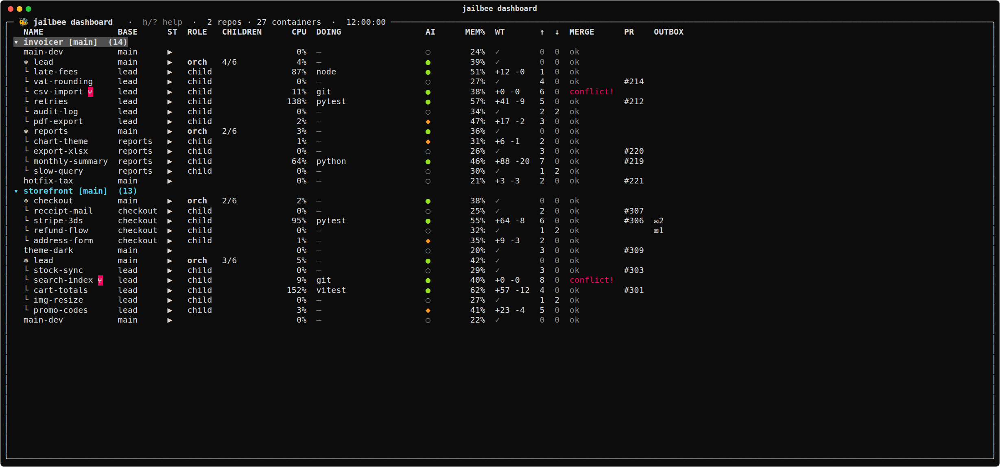

# Orchestrating child containers

How do I hand work to child containers and merge the results?

The short version: you give one container a **grant**, the agent inside it
(the *orchestrator*) starts child containers, briefs them, answers their
questions, brings their commits home and cleans up. You stay in the loop on
the host: the grant bounds what the agent may do, and nothing reaches GitHub
until you publish it.

This is what it looks like in [the terminal dashboard](dashboard.md): two
repos, each with orchestrators (`⎈`, role `orch`, a `CHILDREN` count such as
`4/6` for running/limit) and their children listed under them with `└`.



## Prerequisites

- A repo set up with `jailbee apply` and a coding agent enabled (see
  [Claude Code in the container](getting-started.md#claude-code-in-the-container)).
  The orchestrator and its children run an agent, and the agent needs the
  bundled `jailbee-orchestration` and `jailbee-orchestration-child` skills,
  which `jailbee apply` and `jailbee new` copy in.
- The repo must not forbid orchestration, and the orchestrator must be a
  clone-mode container (mount-mode containers are refused).

## First run: two children, start to finish

The sequence below runs on the host unless marked otherwise.

### 1. Create the orchestrator and grant it

```bash
jailbee new orch                           # a container for the orchestrator
jailbee orchestrate grant orch --children 2
jailbee orchestrate show orch              # the grant, and what the repo leaves of it
```

`--children 2` is the most children **running** at once; more spawns wait in
a queue. Without flags a grant starts from your
[`orchestration.default_profile`](config.md#orchestration) or the built-ins
(4 children, no extra mounts, no loose network, no egress). The grant is
stored where the container cannot write it, so the agent cannot widen it.
`grant` also makes sure the host's broker service is running.

Add rights only when the children need them, for example
`--egress pypi.org` or `--mount data`; see
[Grants](orchestration.md#grants).

### 2. Give the orchestrator its task

Attach to the container's agent and describe the work. The grant alone does
not make the agent orchestrate; it has to be asked to use child containers.

```bash
jailbee tmux orch                          # attach to the agent's tmux session
```

A prompt that works:

```text
Orchestrate two child containers. One child per task:
1. branch `fix/rounding`: fix the VAT rounding bug in invoice totals;
   `uv run pytest tests/test_totals.py` must pass.
2. branch `feat/csv-import`: add CSV import; `uv run pytest tests/test_import.py` must pass.
Brief each child with the task, the relevant files and the acceptance tests.
Merge their work into your branch when they report done, and ask me if
anything is unclear.
```

The agent loads its `jailbee-orchestration` skill and, inside the container,
runs `jailbee inbox send spawn …` once per child. Give each task as a whole
unit (a ticket or a plan); the child splits it into steps itself.

### 3. Watch the children

Children appear within seconds:

```bash
jailbee ls --fields name,role,children,state,agent,inbox
jailbee orchestrate show orch              # grant plus running children
jailbee orchestrate messages orch          # what the broker holds for it
jailbee dashboard                          # the tree view above
```

Each child is a normal container with its own branch, checkout and agent
session; `jailbee tmux fix-rounding` attaches to one if you want to look.
Children cannot see each other, only talk to the orchestrator.

### 4. Answer a child's question

A child that gets stuck sends a `question` (or `blocked`). The orchestrator
reads it in its inbox and either answers it itself or asks you in its own
conversation. If it asks, answer in the orchestrator's tmux window; the
orchestrator relays your answer with `jailbee inbox send message`. You never
have to reach into a child.

The `inbox` field of `jailbee ls --fields …` shows unread messages for a
container, so a waiting question is visible without attaching.

### 5. Import and merge

When a child is finished and has committed everything, it sends `done`. The
host broker then **fetches the child's branch and imports it into the
orchestrator** at `refs/jailbee/from/<child>/<branch>`, and delivers `done`
with that ref. Nothing is merged automatically: the orchestrator runs the
`git merge` itself, resolves conflicts and commits. A child with uncommitted
changes or a detached `HEAD` is refused at `done` and has to fix that first.

With the default `on_done: destroy` the broker removes the child after
delivery, which frees a slot for the next queued spawn.

### 6. Bring the result home and clean up

The orchestrator's branch now holds both fixes. On the host, take it the
same way as any container's work:

```bash
jailbee git checkout orch                  # the combined branch on the host
git push -u origin orch                    # or: jailbee pr push orch
```

Then tidy up:

```bash
jailbee ls                                 # children should be gone (destroy on done)
jailbee orchestrate revoke orch            # stop new spawns when you are finished
jailbee destroy orch
```

`revoke` leaves existing children alone. A child that was kept (for example
because it had unpublished GitHub proposals) is destroyed with
`jailbee destroy <child>`, or by the orchestrator when the grant allows
`destroy`.

## Children or subagents?

| | Subagent | Child container |
|---|---|---|
| Where it runs | The orchestrator's own container and work tree | Its own container, checkout, branch and agent session |
| Good for | Investigation, review, light text or docs edits | Code with test suites, services, long multi-step work, whole plans |
| Costs | Context in the orchestrator's session | A container slot against the grant's limit |
| Result | Returned straight to the agent | Commits, imported and merged on `done` |

Rule of thumb: if the work needs to run programs or change code, give it a
child; if it only reads or writes a little text, a subagent is cheaper. One
child takes one whole ticket or plan, never a slice of one. The skills encode
the same rule; their source is
[`jailbee-orchestration`](https://github.com/VRTFinland/jailbee/blob/main/docs/skills/jailbee-orchestration/SKILL.md)
and
[`jailbee-orchestration-child`](https://github.com/VRTFinland/jailbee/blob/main/docs/skills/jailbee-orchestration-child/SKILL.md).

## Concurrency and the grant

- `max_running_children` limits children that are **running** at once.
  Stopped children do not count. A spawn over the limit is queued in order and
  starts when a slot frees.
- Lowering the limit leaves running children untouched and holds the queue
  until the running count falls below it.
- `operations` lists what the agent may do: `spawn`, `message`, `import`,
  `restart`, `stop`, `destroy`, `rights` (`refresh` for service refreshes).
  `spawn` and `message` are in every grant. Leave one out with
  `--deny destroy`; then finished children are kept instead of destroyed.
- `grantable` bounds what the agent may give a child: optional mounts, loose
  network, extra egress hosts.
- Edit a grant by running `jailbee orchestrate grant orch …` again; it keeps
  the fields you do not name. Save a grant you reuse with
  `jailbee orchestrate profile save`. In the dashboard, `Orchestration…`
  (`G`) in a container's menu does the same.

Details: [Grants](orchestration.md#grants) and
[Lifecycle](orchestration.md#lifecycle).

## What children can and cannot do

- A child can **message only its orchestrator**: `note`, `question`,
  `blocked`, `done`. It cannot talk to other children or to you directly.
- It cannot spawn children, merge into other branches, push, open PRs or
  destroy containers.
- It has **no outbox of its own**. To get an issue, comment or PR review
  onto GitHub, a child sends the exact repository, target and content to its
  orchestrator, which stages it in its own outbox. You publish it on the host
  as usual; see [Working with GitHub](github.md). A child that finishes with
  proposals still pending is kept rather than destroyed, so nothing is lost.
- Its rights (egress, mounts, loose network) are what the orchestrator grants,
  within the grant. The child can give rights up, never ask itself for more.
- It inherits git commits only. A plan or notes the child needs must be
  committed, in a shared host mount, or in the prompt (capped at 64 KiB).

## Reading child state

| Where | What it shows |
|---|---|
| Dashboard NAME column | `⎈` marks an orchestrator; children are indented under it with `└`; `⑂` marks a child whose orchestrator is not listed |
| `ROLE` and `CHILDREN` | `orch` / `child`; running over limit, such as `4/6` |
| `AI` and `DOING` | Whether each agent is working, idle or waiting for you, and what it runs |
| `OUTBOX` | Staged GitHub proposals waiting for you to publish |
| `jailbee orchestrate show` | The grant and the running children |
| `jailbee orchestrate messages [name] [--all]` | The broker's stored messages, read-only; `--json` for scripts |

Which columns show is yours to pick in the dashboard's settings overlay
(`F2`).

## Already have containers running?

`jailbee orchestrate adopt orch worker1 worker2` makes existing containers
children of `orch`, within its limit. `jailbee orchestrate release worker1`
undoes it. See [Adopt running containers](orchestration.md#adopt-running-containers).

## More

- [Container orchestration](orchestration.md): the full reference (grants,
  profiles, child rights, the broker, lifecycle)
- [Orchestration protocol](orchestration-protocol.md): the wire schema
- [Working with GitHub](github.md): how a child's proposals reach GitHub
- [Commands](commands.md): `jailbee orchestrate` flags
